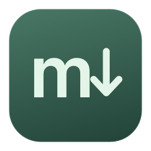
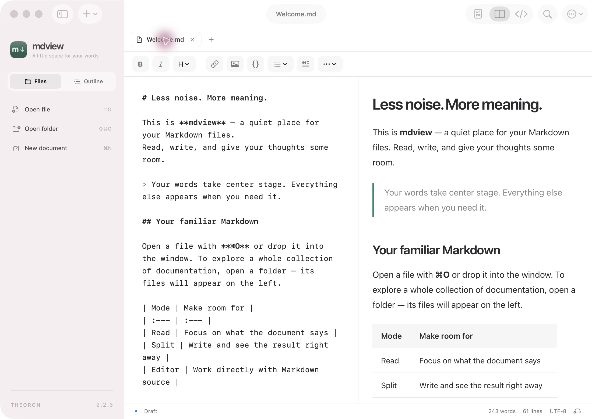

  

<h1 align="center">mdview</h1>

Мінімалістичний застосунок для читання й редагування Markdown на macOS · by <a href="https://github.com/theoron-apps">Theoron</a>

  
  
  
  

  <a href="https://github.com/theoron-apps/mdview/releases"><b>Завантажити pre-release</b></a> ·
  <a href="README.md">English</a> · <a href="README.ru.md">Русский</a> · Українська

  

---

## Можливості

Файл із Finder відкривається в легкому вікні для читання. Кнопка **«Відкрити в mdview»** переносить документ у повний робочий простір для редагування.

- **Три режими:** читання, вихідний Markdown і редактор поруч із попереднім переглядом.
- **Документи поруч:** вкладки, папки, нещодавні файли, зміст і пошук.
- **Інструменти редагування:** заголовки H1–H6, жирний, курсив, посилання, зображення, код, списки, цитати, таблиці та скасування дій.
- **Markdown офлайн:** таблиці, списки завдань, підсвічування коду, діаграми Mermaid і формули KaTeX.
- **Налаштування для себе:** світла й темна теми, шрифти, ширина сторінки, чотири стилі панелі інструментів і Liquid Glass у підтримуваних версіях macOS.
- **Зручність:** автозбереження наявних файлів, відновлення чернеток, перевірка зовнішніх змін і експорт PDF через системний друк.
- **Українська, російська й англійська** мови інтерфейсу.

## Встановлення

1. Відкрийте [Releases](https://github.com/theoron-apps/mdview/releases) і виберіть попередній випуск.
2. Завантажте **mdview-0.2.3.dmg**, відкрийте образ і перетягніть **mdview** до **Applications / Програми**.
3. Вийміть образ і запустіть mdview із «Програм».

Для оновлення закрийте mdview і замініть наявний застосунок. Перевірку оновлень у цій збірці ще не підключено; нові версії доступні в Releases.

**Збірка має локальний ad-hoc підпис і не пройшла нотаризацію Apple.** macOS може заблокувати перший запуск. Якщо ви довіряєте завантаженню, скористайтеся [інструкцією Apple](https://support.apple.com/en-au/102445). До випуску додається контрольна сума SHA-256.

## Вимоги

**0.2.3 · збірка 5 · pre-release.** Можливості й оформлення ще змінюються. Зберігайте резервні копії важливих документів. Про проблеми повідомляйте через [Issues](https://github.com/theoron-apps/mdview/issues), зазначивши версії macOS і застосунку та кроки для відтворення.

| | Підтримка |
| --- | --- |
| Мінімальна система | macOS 13 |
| Процесори | Universal: Apple Silicon та Intel |
| Liquid Glass | macOS 26 і новіші; системні матеріали на попередніх версіях |
| Перевірено | Apple Silicon та x86_64 через Rosetta на комп’ютері розробника |
| Ще не перевірено | Старі macOS, фізичний Intel Mac і встановлення на чистому Mac |

Редагування відбувається у вихідному Markdown. Стан списків завдань змінюється у вихідному тексті; MDX не виконує JSX-компоненти.

## Приватність

Документи залишаються у вибраних папках. Відтворення Markdown працює без мережі. Зовнішні зображення початково вимкнені; їх можна ввімкнути в налаштуваннях. mdview не надсилає документи й не збирає аналітику.

Історія версій доступна в **«Налаштування → Що нового»**.

## Про цей репозиторій

Тут розміщено сторінку проєкту й готові випуски. Вихідний код застосунку не опубліковано; відкриту ліцензію для mdview не надано. Сторонні компоненти зберігають свої ліцензії: [повідомлення та тексти ліцензій](THIRD_PARTY.md).

## Зв’язок

Новини та підтримка — Telegram [@TheoronApps](https://t.me/TheoronApps).
